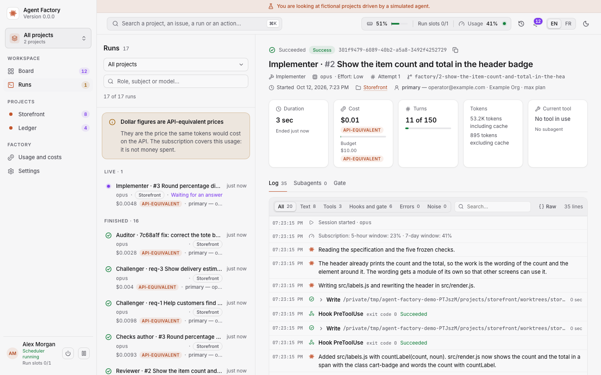
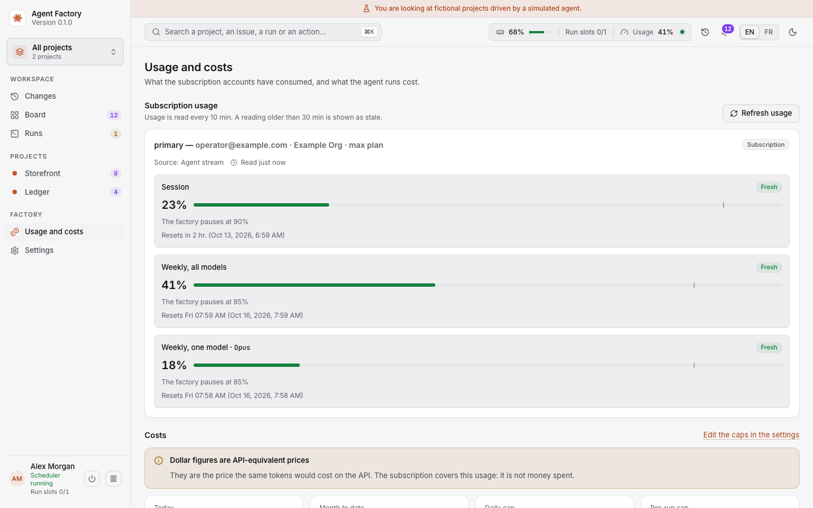

<h1 align="center">Agent Factory</h1>

<p align="center">
  An agentic software factory: it drives Claude Code from a validated issue
  specification to a proof-carrying pull request, on any repository, with a live
  cockpit to follow and steer every step.
</p>

<p align="center">
  <a href="https://github.com/RachidChabane/agent-factory/actions/workflows/ci.yml"></a>
  <a href="https://github.com/RachidChabane/agent-factory/releases"></a>
  <a href="LICENSE"></a>
  
  <a href="https://codecov.io/gh/RachidChabane/agent-factory"></a>
</p>

<p align="center">
  
</p>

## What it does

- **From a spec to a proven pull request.** An issue validated by the operator gets
  acceptance checks written by one agent and proven to fail on the base, an
  implementation by another agent held by a deterministic gate, an independent review,
  and a pull request with its evidence before and after. The merge happens on the
  operator's order.
- **Any repository, any stack.** Setup and gate commands, issue types and their proof
  rules, roles and their models, environments and releases, connected tools: all in
  one configuration file with a published schema. `agent-factory init` writes it from
  what the repository already uses.
- **Several projects, one cockpit.** A board across projects, requests and their
  challenge, issues and their dependencies, pull requests, runs with their live logs,
  delivery, audits of outside changes, subscription usage and costs. Every value says
  when it was read; every button acts on the factory and shows its answer.
- **Confined and frugal.** Agents and check commands run in the operating system's
  sandbox, away from credentials and from other projects. The factory reads the
  subscription's usage for free and pauses before a limit, and watches the machine's
  memory.
- **Rehearse before going live.** A local forge runs the whole cycle against your
  repository's code without reaching GitHub; the demonstration runs it on fictional
  projects with no account at all.

## Start in five minutes

You need Node.js 24.11 or later, pnpm 10 and git, on macOS or Linux (with
[bubblewrap](https://github.com/containers/bubblewrap)).

```sh
git clone https://github.com/RachidChabane/agent-factory.git
cd agent-factory
script/setup                     # installs the dependencies and builds the cockpit
script/factory start --demo
```

Open <http://127.0.0.1:7431>. The demonstration plays a working week of two
fictional teams on local forges, with a fake Claude: requests arrive and are
challenged, issues run through the whole cycle, an agent asks a decision, a pull
request is merged, an outside change is audited and a release waits on its gate.
Nothing needs an account, a token or the network, and the demonstration removes its
files when it stops (Ctrl-C).

## Use it on your repository

1. Install and log in to [Claude Code](https://docs.claude.com/en/docs/claude-code)
   (`claude`), and to the [GitHub CLI](https://cli.github.com) (`gh auth login`) for a
   GitHub repository.
2. From your repository: `/path/to/agent-factory/script/factory init`. It writes
   `~/.agent-factory/config.yaml` from what it finds; review it.
3. `script/factory validate` checks the tools, the forge, the labels, and runs your
   gate on a clean checkout of the base.
4. `script/factory start`, then open <http://127.0.0.1:7430>. Validate a spec from the
   cockpit and the factory takes it.

[Add a project](docs/adding-a-project.md) covers the gate, issue types, the sandbox,
a stack for user-interface checks and the rehearsal on a local forge. The
[operator guide](docs/operator-guide.md) follows a day with the factory.

## How an issue goes through

| Step | Who | What happens |
|---|---|---|
| Validate the spec | the operator | a draft with its acceptance criteria becomes work |
| Write the checks | an agent | checks that prove each criterion from the outside |
| Prove them red | the factory | they fail on the base by assertion, then are frozen by hash |
| Implement | an agent | the change, held by the gate until frozen checks, lint and tests pass |
| Gate again | the factory | in its own sandbox |
| Review | an agent | in a fresh context, against the spec and the checks |
| Open the pull request | the factory | with the evidence before and after |
| Merge | the operator | squash, once the evidence folder is removed |

Failures retry within bounds (two corrections, one fresh restart), then the issue
waits for a person with the reason. See [the architecture](docs/ARCHITECTURE.md).

## Screenshots

| | |
|---|---|
|  |  |
|  |  |
|  | |

The screenshots come from the demonstration and are regenerated by
`script/screenshots`.

## Documentation

- [Architecture](docs/ARCHITECTURE.md)
- [Configuration reference](docs/configuration.md), and the [JSON Schema](schema/config.schema.json)
- [Operator guide](docs/operator-guide.md)
- [Add a project](docs/adding-a-project.md)
- [Design decisions](docs/adr)

## Contributing

[CONTRIBUTING.md](CONTRIBUTING.md) has the commands. Security issues:
[SECURITY.md](SECURITY.md). Changes are listed in [CHANGELOG.md](CHANGELOG.md).

## License

[Apache-2.0](LICENSE). Third-party licences: [THIRD_PARTY_NOTICES.md](THIRD_PARTY_NOTICES.md).
