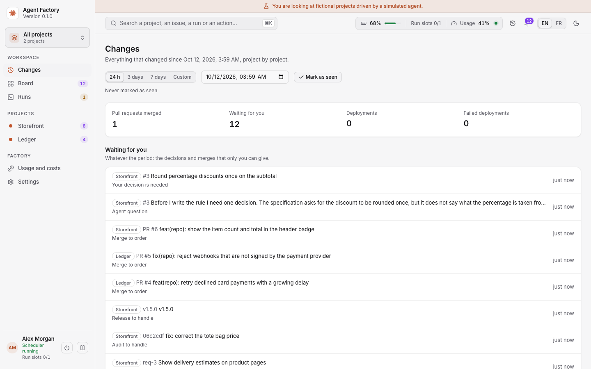
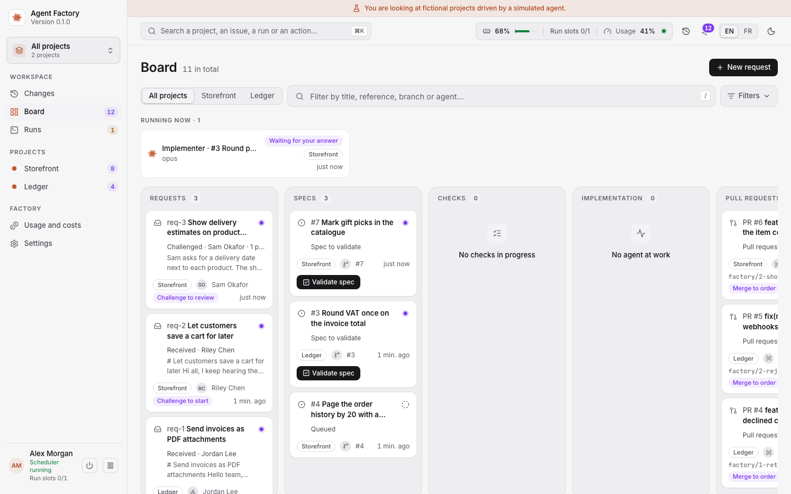
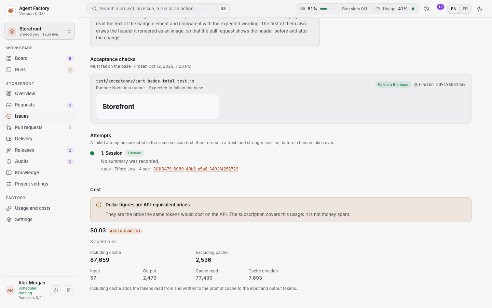
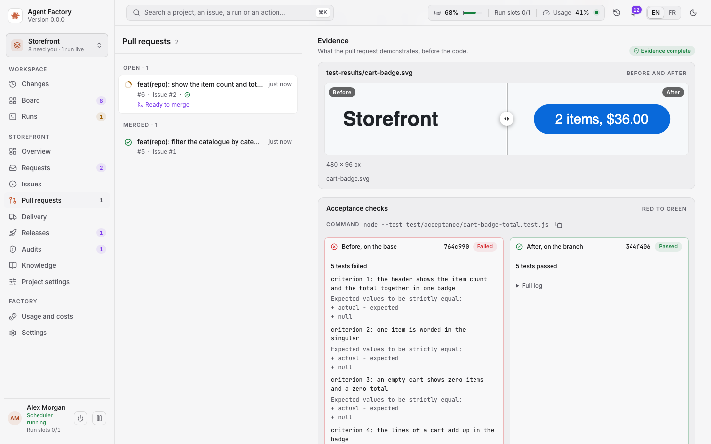
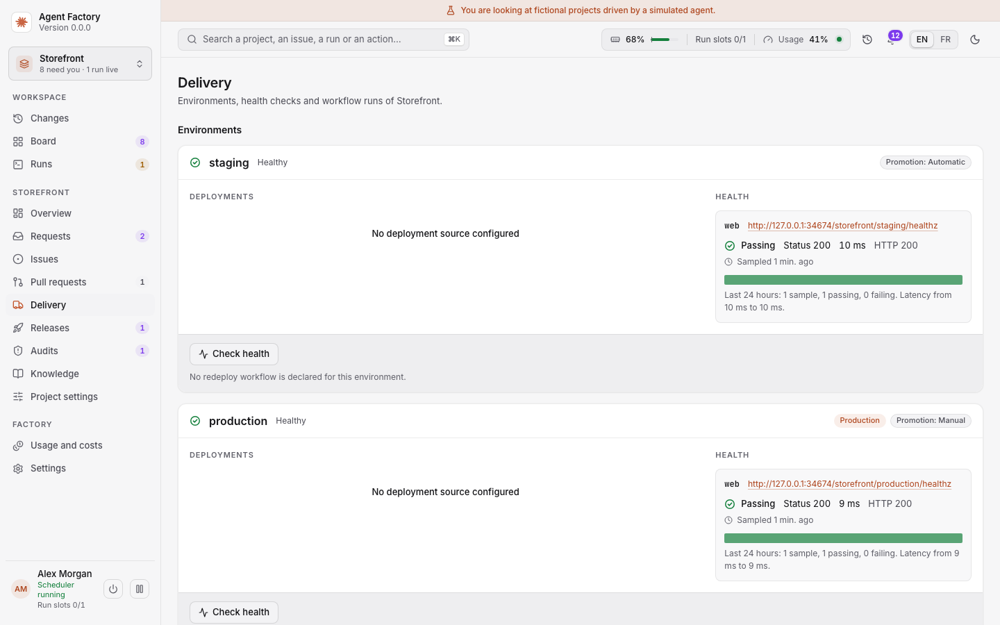

<h1 align="center">Agent Factory</h1>

<p align="center">
  An agentic software factory: it drives Claude Code from a validated issue
  specification to a proof-carrying pull request, on any repository, with a live
  cockpit to follow and steer every step.
</p>

<p align="center">
  <a href="https://github.com/RachidChabane/agent-factory/actions/workflows/ci.yml"></a>
  <a href="https://github.com/RachidChabane/agent-factory/releases"></a>
  <a href="LICENSE"></a>
  
  <a href="https://codecov.io/gh/RachidChabane/agent-factory"></a>
</p>

<p align="center">
  <br>
  <sub>The Changes page, where the cockpit opens: the counts of the period and what waits for you.</sub>
</p>

## What it does

- **From a spec to a proven pull request.** An issue validated by the operator gets
  acceptance checks written by one agent and proven to fail on the base, an
  implementation by another agent held by a deterministic gate, an independent review,
  and a pull request with its evidence before and after. The merge happens on the
  operator's order.
- **Any repository, any stack.** Setup and gate commands, issue types and their proof
  rules, roles and their models, environments and releases, connected tools: all in
  one configuration file with a published schema. `agent-factory init` writes it from
  what the repository already uses.
- **Several projects, one cockpit.** A board across projects, requests and their
  challenge, issues and their dependencies, pull requests, runs with their live logs,
  delivery, audits of outside changes, subscription usage and costs, and a Changes page
  that opens on what moved since you last looked. Every value says when it was read;
  every button acts on the factory and shows its answer.
- **Confined and frugal.** Agents and check commands run in the operating system's
  sandbox, away from credentials and from other projects. The factory reads the
  subscription's usage for free and pauses before a limit, and watches the machine's
  memory.
- **An orchestrator for the day-to-day.** The repository is a Claude Code marketplace:
  `/plugin install agent-factory --marketplace RachidChabane/agent-factory` adds an
  agent, started with `claude --agent agent-factory:orchestrator`, that writes specs,
  watches what blocks the factory with `agent-factory watch`, unblocks escalations,
  merges within the autonomy you delegate and reports each morning
  ([how it works](docs/operator-guide.md#working-with-the-orchestrator)).
- **Rehearse before going live.** A local forge runs the whole cycle against your
  repository's code without reaching GitHub; the demonstration runs it on fictional
  projects with no account at all.

## Start in five minutes

You need Node.js 24.11 or later, pnpm 10 and git, on macOS or Linux (with
[bubblewrap](https://github.com/containers/bubblewrap)).

```sh
git clone https://github.com/RachidChabane/agent-factory.git
cd agent-factory
script/setup                     # installs the dependencies and builds the cockpit
script/factory start --demo
```

Open <http://127.0.0.1:7431>. The demonstration plays a working week of two
fictional teams on local forges, with a fake Claude: requests arrive and are
challenged, issues run through the whole cycle, an agent asks a decision, a pull
request is merged, another is filmed before and after the change, an outside change
is audited and a release waits on its gate. The film comes from a stand-in film
command: ordering the scenario `unavailable-scenario` from a pull request page shows a
film that fails. The orchestrator of the storefront validates one spec under the project's
autonomy policy, and the project overview lists that decision; the filmed pull request's
ready notice links its films, made reachable by a stand-in upload command that copies them
into the demonstration's home. Nothing needs an account, a token or the network, and the
demonstration removes its files when it stops (Ctrl-C).

## Use it on your repository

1. Install and log in to [Claude Code](https://docs.claude.com/en/docs/claude-code)
   (`claude`), and to the [GitHub CLI](https://cli.github.com) (`gh auth login`) for a
   GitHub repository.
2. From your repository: `/path/to/agent-factory/script/factory init`. It writes
   `~/.agent-factory/config.yaml` from what it finds; review it.
3. `script/factory validate` checks the tools, the forge, the labels, and runs your
   gate on a clean checkout of the base.
4. `script/factory start`, then open <http://127.0.0.1:7430>. Validate a spec from the
   cockpit and the factory takes it.

[Add a project](docs/adding-a-project.md) covers the gate, issue types, the sandbox,
a stack for user-interface checks and the rehearsal on a local forge. The
[operator guide](docs/operator-guide.md) follows a day with the factory.

## How an issue goes through

| Step | Who | What happens |
|---|---|---|
| Validate the spec | the operator | a draft with its acceptance criteria becomes work |
| Write the checks | an agent | checks that prove each criterion from the outside |
| Prove them red | the factory | they fail on the base by assertion, then are frozen by hash |
| Implement | an agent | the change, held by the gate until frozen checks, lint and tests pass |
| Gate again | the factory | in its own sandbox |
| Review | an agent | in a fresh context, against the spec and the checks |
| Open the pull request | the factory | with the evidence before and after |
| Merge | the operator | squash, once the evidence folder is removed |

Failures retry within bounds (two corrections, one fresh restart), then the issue
waits for a person with the reason. See [the architecture](docs/ARCHITECTURE.md).

## Screenshots

| | |
|---|---|
| <br><sub>The board: the work of two projects by state, from request to delivery.</sub> | <br><sub>An issue: its acceptance checks, frozen before the code, its attempts and its cost.</sub> |
| <br><sub>A pull request: its evidence before and after, and its acceptance checks red on the base, green on the branch.</sub> | <br><sub>Delivery: the environments of a project and the health checks of each.</sub> |
| <br><sub>A run: what the agent did, step by step, with its cost and its turns.</sub> | <br><sub>Usage: the subscription's limits by account, and the costs of the runs.</sub> |

The screenshots come from the demonstration and are regenerated by
`script/screenshots`.

## Documentation

- [Architecture](docs/ARCHITECTURE.md)
- [Configuration reference](docs/configuration.md), and the [JSON Schema](schema/config.schema.json)
- [Operator guide](docs/operator-guide.md)
- [Add a project](docs/adding-a-project.md)
- [Design decisions](docs/adr)

## Contributing

[CONTRIBUTING.md](CONTRIBUTING.md) has the commands. Security issues:
[SECURITY.md](SECURITY.md). Changes are listed in [CHANGELOG.md](CHANGELOG.md).

## Where it comes from

Agent Factory is the final version of an idea started in September 2025: let Claude
Code carry a task to the end on its own, and hold it to checks it cannot talk its way
past.

- [Claude Autopilot](https://github.com/RachidChabane/cc-mvp-scaffold) (2025) ran the
  tasks of a project one after the other through Claude Code, with quality gates
  between them and a watchdog over the session.
- [Claude Plan Execute](https://github.com/RachidChabane/claude-plan-execute) (2026)
  turned that into a plan, review and implement runner with declared gates, captured
  failures and an audit trail for each task.

## License

Copyright (C) 2026 Rachid Chabane.

[AGPL-3.0](LICENSE): use it, fork it and change it; a version you distribute or offer
to others over a network stays open under the same license, with its notices.
Third-party licences: [THIRD_PARTY_NOTICES.md](THIRD_PARTY_NOTICES.md).
